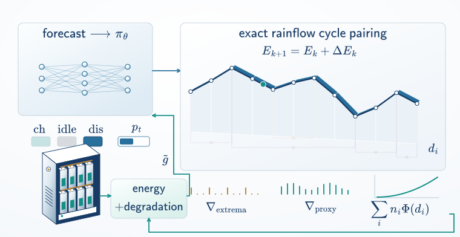

<h1 align="center">Battery-MI-DPC</h1>

<p align="center">
  <a href="https://solaris-jhu.github.io/Battery-MI-DPC/"></a>
  <a href="https://doi.org/10.1109/TSG.2026.3737375"></a>
  <a href="https://arxiv.org/abs/2609.12968"></a>
  <a href="https://colab.research.google.com/github/SOLARIS-JHU/Battery-MI-DPC/blob/main/Battery-MI-DPC.ipynb"></a>
  <a href="Battery-MI-DPC.ipynb"></a>
  <a href="https://www.python.org/"></a>
  <a href="https://pytorch.org/"></a>
</p>

<p align="center"><b>End-to-End Battery Dispatch with Exact Rainflow Degradation via Mixed-Integer Differentiable Predictive Control</b></p>

<p align="center">Eshagh Safarzadeh Ravajiri, Jan Drgona, Mahdi Mehrtash, and Benjamin F. Hobbs</p>

Companion research notebook for the paper published in [*IEEE Transactions on Smart Grid*](https://ieeexplore.ieee.org/document/11707737/), Early Access, 2026.

The [project website](https://solaris-jhu.github.io/Battery-MI-DPC/) presents the method, paper figures, results, and citation. Its source lives in [`website/`](website/), following the organization of [TQPNet](https://github.com/SOLARIS-JHU/TQPNet). See the [website README](website/README.md) for local preview and maintenance, and the [source map](website/research/source-map.md) for scientific provenance and paper/code differences.

---

## The Battery Dispatch Problem

Battery dispatch balances electricity import and export costs against degradation from charge–discharge cycles. The controller must choose charging, discharging, or idle modes and power schedules while accounting for battery dynamics and operating limits. Rainflow cycle counting connects the resulting state-of-charge trajectory to cycle degradation.

<p align="center">
  <a href="https://solaris-jhu.github.io/solaris-website/papers.html#energy-systems">
    
  </a>
</p>

## The MI-DPC Framework

Mixed-integer differentiable predictive control (MI-DPC) learns battery charge, discharge, and idle decisions together with continuous power schedules from solar-generation, demand, and electricity-price profiles. The notebook combines:

- A PyTorch neural policy with Gumbel–Softmax mode selection during training and discrete mode selection at inference.
- Explicit battery state-of-charge (SOC) dynamics and grid power balance.
- Rainflow cycle counting in the forward degradation-cost calculation, with a custom backward pass combining cycle-extrema and dense proxy gradients.
- Self-supervised training using energy cost, degradation cost, and constraint penalties.
- A piecewise-linear mixed-integer linear programming (PWL-MILP) baseline and a quadratic-program (QP) projection routine.

The backward pass uses a hybrid gradient; “exact rainflow” refers to the forward cycle-counting calculation, not an exact derivative of the entire training objective.

## Open in Google Colab

1. Select **Open In Colab** above. The link opens the notebook directly from this repository's `main` branch.
2. Connect to a Python runtime. The supplied code uses CPU tensors; selecting a GPU alone does not move the model or data to it.
3. Run the dependency-installation cell in Section 1, then run the imports and definitions in Sections 1–6.
4. Run Section 7 to train a policy on generated synthetic profiles. For a short workflow check, reduce `num_train` to `128`, `hidden_dim` to `128`, `n_epochs` to `20`, and `batch_size` to `16` in that cell. This is a demonstration configuration, not the paper's training setup.
5. Follow the checkpoint requirements below before running Sections 8 and 10. Save a copy in Drive to retain notebook edits. Download generated files or copy them explicitly to mounted Drive before the Colab runtime ends.

**The repository does not currently include `model_15min_div_16.pt`.** Sections 8 and 10 both load this fleet-trained checkpoint. A fresh “Run all” will therefore stop at the checkpoint-loading cell even after synthetic training succeeds. Sections 1–7 and the Section 9 synthetic data generator do not require that file.

## Dependencies and solvers

The notebook's setup cell installs:

```python
%pip install numpy scipy pandas matplotlib torch cvxpy osqp rainflow pyomo cvxopt
```

The packages are not version-locked. The original notebook metadata records Python 3.13.5; no complete original environment lockfile is included.

| Component | Dependency / requirement |
| --- | --- |
| Policy and training | PyTorch, NumPy |
| Rainflow degradation | `rainflow` |
| Numerical utilities and tables | SciPy, pandas, Matplotlib |
| Optimization models and projection | CVXPY; OSQP for the QP projection |
| Existing imports | Pyomo |
| PWL-MILP baseline | Gurobi, GLPK_MI, or CBC, in that priority order |

Installing `cvxopt` supplies GLPK support on platforms with the bundled GLPK build. Confirm availability with `cvxpy.installed_solvers()`; the setup cell prints this list. See the [CVXPY solver installation instructions](https://www.cvxpy.org/install/index.html#install-with-additional-solver-support).

Gurobi is optional for exploring the notebook, but reproducing a Gurobi-based timing comparison requires Gurobi and a suitable license. Installing `gurobipy` alone does not configure a license. The notebook can fall back to GLPK_MI or CBC if installed; timings from a different solver or Colab runtime are not directly comparable to the paper.

## Notebook guide

| Section | Contents |
| --- | --- |
| 1 | Dependency installation and imports |
| 2 | Battery parameters and synthetic profile generation |
| 3 | PWL-MILP baseline: `xu_battery_optimization`, `solve_xu_optimization` |
| 4 | Rainflow cost and utility functions |
| 5 | `RainflowFunction`, the `L2O` policy, and training routine |
| 6 | `project_to_feasible` and SOC-violation screening |
| 7 | Synthetic-data training |
| 8 | Loading the external fleet-trained checkpoint |
| 9 | Out-of-distribution (OOD) synthetic profiles |
| 10 | In-distribution/OOD comparison and summary table |
| 12 | Saved illustrative result tables and discussion |

The current notebook skips Section 11. Default settings are a 10 kWh battery, 4.8 kW charge/discharge limits, 15-minute intervals over 24 hours (96 steps), 0.92 charge/discharge efficiencies, and SOC bounds of 10–90%. Section 7 generates 10,000 training profiles and requests 1,500 epochs with hidden width 1,024 and batch size 48. It is a full training run, not an instant preview.

## Fleet checkpoint and full evaluation

To run the existing full comparison, place the author-provided `model_15min_div_16.pt` in the notebook's working directory. In Colab, upload it through the Files panel or change **both** loading paths in Sections 8 and 10 to its location. Run the class definitions before loading it.

The checkpoint uses `torch.load(..., weights_only=False)`, so use a checkpoint from a trusted source. The repository contains neither that checkpoint nor the real-data fleet training dataset. The current evaluation cell generates synthetic in-distribution and OOD profiles; it does not implement the paper's complete year-long real-data evaluation.

For a synthetic-only exploration, run through Section 7 and skip the checkpoint-dependent cells. To adapt Section 10, remove both `model_midpc_2 = torch.load(...)` and `model_midpc_2.eval()`, plus the `MI-DPC (real)` evaluation call while retaining the synthetic policy and PWL baseline.

## Interpreting results

- Training and evaluation generate random profiles; the notebook does not fix random seeds. Saved outputs are examples from a prior run, not results guaranteed by a new run.
- Cost differences reported against PWL are comparisons with that baseline, not certificates of global optimality for the exact rainflow problem.
- The supplied QP routine constrains SOC dynamics, SOC bounds, and charging/discharging power bounds. It does not explicitly lock the predicted modes or impose a terminal-SOC equality.
- Section 10 checks unprojected SOC with a 0.1 kWh tolerance and assigns `feasible=True` to projected rows without a fresh complete constraint check. Inspect solver status and constraint residuals before interpreting those flags as feasibility evidence.

Refer to the published paper for the formal formulation, assumptions, and reported experimental results.

## Local use

Open `Battery-MI-DPC.ipynb` in JupyterLab or another Jupyter-compatible editor using a Python environment with the dependencies above. Run the Section 1 installation cell in that environment, then follow the same execution order and checkpoint requirements as in Colab.

## Citation

```bibtex
@article{ravajiri2026battery,
  author = {Ravajiri, Eshagh Safarzadeh and Drgona, Jan
            and Mehrtash, Mahdi and Hobbs, Benjamin F.},
  title = {End-to-End Battery Dispatch with Exact Rainflow
           Degradation via Mixed-Integer Differentiable
           Predictive Control},
  journal = {IEEE Transactions on Smart Grid},
  year = {2026},
  note = {Early Access},
  doi = {10.1109/TSG.2026.3737375},
  url = {https://ieeexplore.ieee.org/document/11707737/}
}
```
